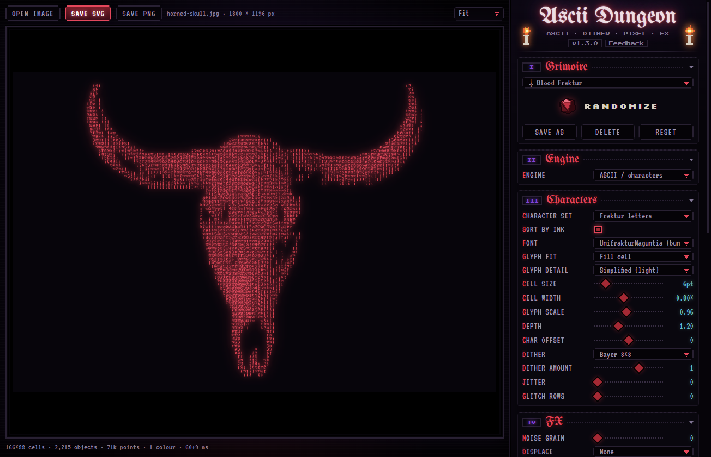
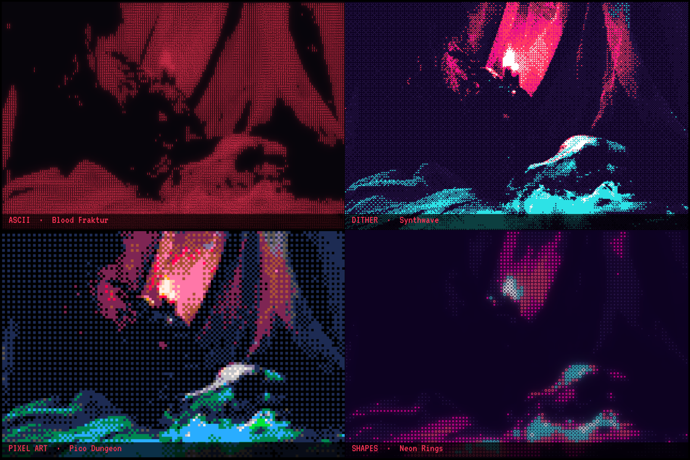
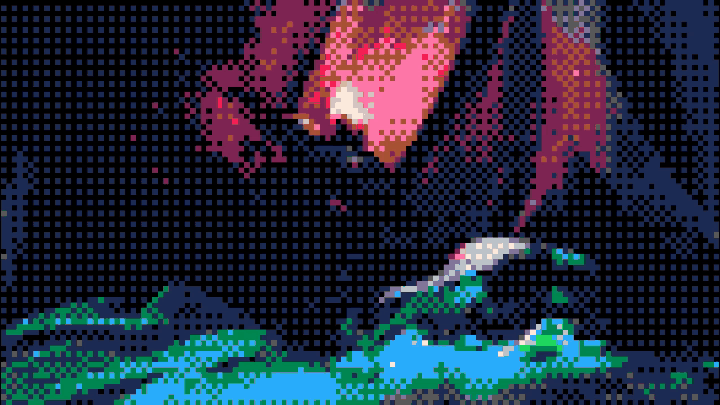
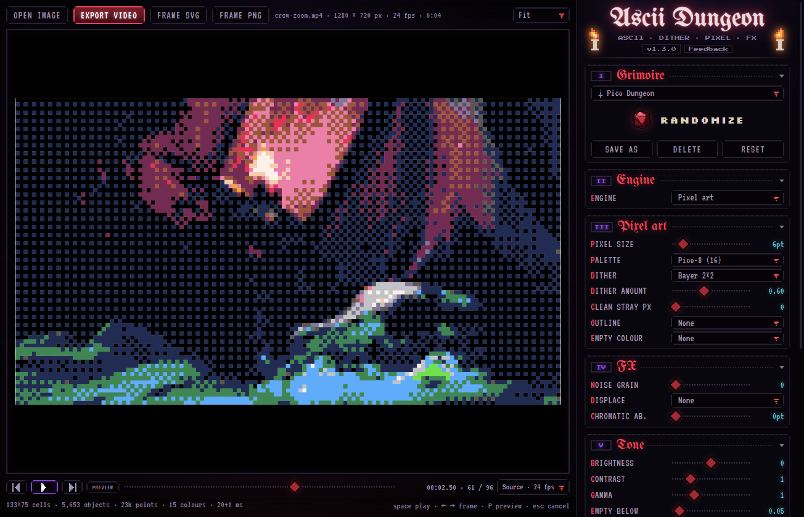
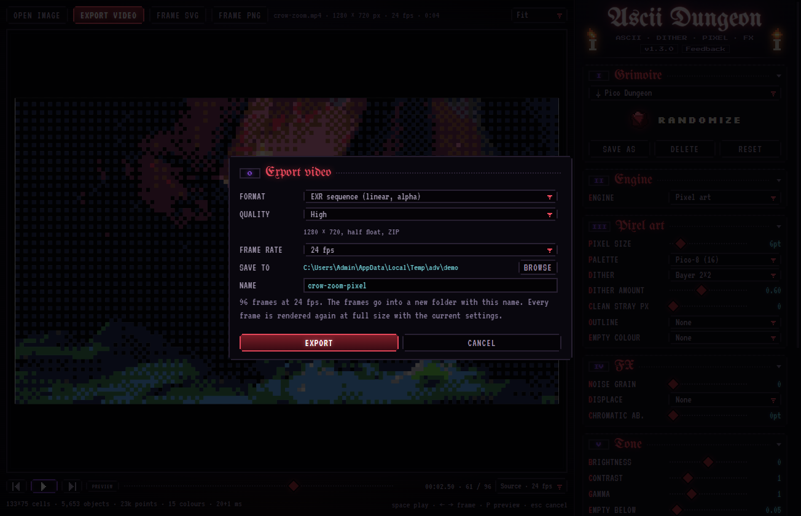

# ⸸ ASCII Dungeon ⸸

**Turn pictures and video into ASCII, dither, pixel art and shape patterns.**
As vector art you can keep editing, or as images and video.

A standalone app for Windows, a plugin for Adobe Illustrator and a plugin for VectorCraft.

[**Download the latest version**](https://github.com/4ebass-cmyk/ascii-dungeon-releases/releases/latest) · [What's new](https://github.com/4ebass-cmyk/ascii-dungeon-releases/releases) · [Report a bug](https://github.com/4ebass-cmyk/ascii-dungeon-releases/issues/new?labels=bug)

## Four engines, one window

| Engine | What it makes |
|---|---|
| **ASCII** | Characters on a grid: Fraktur, capitals, classic `.:-=+*#%@`, blocks `░▒▓█`, binary, hex, your own set. Any installed font, with glyphs fitted to the cell or on a monospace grid. |
| **Dither** | 1-bit to 32 colours with Bayer, halftone, blue noise, Floyd–Steinberg, Atkinson and more. Palettes from Game Boy and CGA to Risograph. |
| **Pixel art** | Big clean pixels with an automatic or fixed palette (Pico-8, Game Boy…), stray pixel cleanup and outlines. |
| **Shapes** | Dots, squares, crosses, rings and Braille, sized by tone. Halftone and print looks. |

On top of any engine: noise grain, displacement (noise, wave, glitch), chromatic aberration and bloom. Colour can be a single ink, the picture's own colours or a palette by tone, on a transparent or coloured background.

**Before / After** (or the C key) puts the original next to the art with a divider you can drag.

The **Grimoire** has 23 ready looks, and **Randomize** rolls new settings for every engine. Save your own looks as presets.

## Video (App)

Open or drop a video (MP4, MOV, MKV, WebM, AVI and more) and every setting works on it frame by frame.

- **Play** renders live while you move the sliders. **Preview** renders the clip once and plays it in real time with sound, like a RAM preview.
- **Export** to MP4 (H.264 or H.265) with the original sound, or to PNG and EXR sequences with alpha. EXR frames are linear half float, ready for compositing in After Effects or Nuke.
- Quality from Low (720p) to Source (the video's own size and bitrate), and a frame rate of your choice, from 60 down to 8 fps for a choppy retro look.
- Rendering uses every processor core.

## Which one do I need?

| | **ASCII Dungeon App** | **Plugin for Illustrator** | **Plugin for VectorCraft** |
|---|---|---|---|
| Install | `ASCII-Dungeon-App-Setup.exe` | `ASCII-Dungeon-Setup.exe` | `ASCII-Dungeon-VectorCraft-Setup.exe` |
| Input | Open, drop or paste a picture (PNG, JPG, WebP, GIF, BMP, SVG) or a video | The selection in your document | The selection in your document |
| Output | SVG, PNG, MP4, PNG / EXR sequences | Vector art placed over the original, on its own layer | Vector art placed in the document |
| Extras | Video, built-in ffmpeg | Live text (beta): editable text, one line per row | |
| Needs | Windows 10 or 11 | Illustrator 2018 (22) or newer | VectorCraft 0.9 or newer |

All three share the same engine, settings and presets.

## Install

1. Download the installer from the [latest release](https://github.com/4ebass-cmyk/ascii-dungeon-releases/releases/latest).
2. Run it. Windows SmartScreen may warn about an unknown publisher, since the installers are not code signed yet: click **More info**, then **Run anyway**.
3. **App:** start it from the Start menu or the desktop. **Illustrator:** restart Illustrator, then open **Window → Extensions → ASCII Dungeon Plugin**. **VectorCraft:** start ASCII Dungeon from the Start menu; it opens VectorCraft with it.

Updates come inside the app: it checks on every start, and **Update now** installs the new version and restarts.

The App and the VectorCraft plugin run in the Microsoft Edge WebView2 Runtime, which comes with Windows 10 and 11. If it is missing, the app offers the download.

## Tips

- The mouse wheel steps through a selected list or slider. **Alt + drag** moves a slider ten times finer, **double-click** resets it.
- Click a section heading to fold it.
- **C** toggles Before / After. With a video: **Space** plays, **← →** step a frame, **P** renders a preview, **Esc** cancels a render.
- Error diffusion dithers, jitter and glitch change from frame to frame and flicker in motion. Bayer, halftone and blue noise stay steady in video.
- Big grids make heavy files. A larger cell or the Pixel glyph detail keeps Illustrator fast.

## Feedback

Found a bug or missing something? Use **Feedback** next to the version number in the app: it opens a ready issue here with your version, settings and recent errors, and can add a screenshot. Or [open an issue](https://github.com/4ebass-cmyk/ascii-dungeon-releases/issues) directly.

## Credits

- Skull photo in the screenshots: [Unsplash](https://unsplash.com/photos/a-black-and-white-photo-of-a-skull-CXUvSOC2ZS8), with the horns added by an image model.
- Turning skull: rendered in Blender from the [Skull model by Vladimir Petkovic](https://github.com/KhronosGroup/glTF-Sample-Assets/tree/main/Models/ScatteringSkull) (CC0).
- Fonts: UnifrakturMaguntia, Press Start 2P, Silkscreen and VT323, under the SIL Open Font License.
- [opentype.js](https://github.com/opentypejs/opentype.js) (MIT) reads the fonts.
- The App runs video through [ffmpeg](https://ffmpeg.org), a GPL build from [BtbN/FFmpeg-Builds](https://github.com/BtbN/FFmpeg-Builds), shipped as a separate program in its `ffmpeg` folder.
